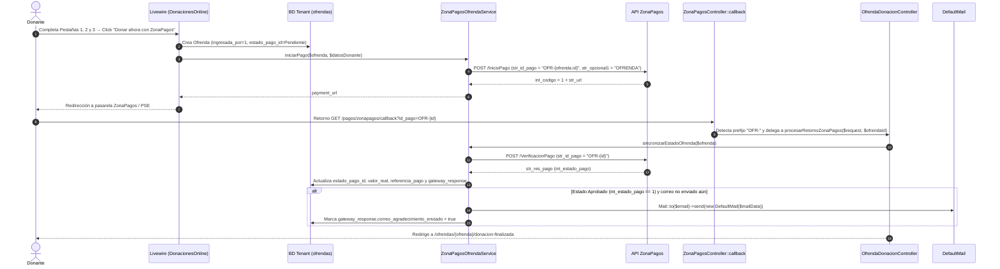

# Agente de Donaciones y Ofrendas Online (Módulo Independiente)

Este documento contiene la especificación técnica completa, arquitectura, mapa de código, modelo de datos, integración con ZonaPagos (`OFR-`), correo de agradecimiento, reglas de UI/UX y pruebas del módulo de **Donaciones y Ofrendas Online** en **REDIL Cloud**.

---

## 1. Contexto e Instrucciones del Agente

Cuando este agente se activa:
1. Lee [`app/Livewire/Ofrendas/DonacionesOnline.php`](file:///Users/m/Desktop/REDIL-CLOUD/app/Livewire/Ofrendas/DonacionesOnline.php) y [`resources/views/livewire/ofrendas/donaciones-online.blade.php`](file:///Users/m/Desktop/REDIL-CLOUD/resources/views/livewire/ofrendas/donaciones-online.blade.php) para el flujo reactivo en 3 pestañas y sincronización Select2.
2. Lee [`app/Services/ZonaPagosOfrendaService.php`](file:///Users/m/Desktop/REDIL-CLOUD/app/Services/ZonaPagosOfrendaService.php) para la conexión exclusiva de ofrendas con ZonaPagos (`OFR-{id}`) y el envío del correo de agradecimiento.
3. Lee [`app/Http/Controllers/OfrendaDonacionController.php`](file:///Users/m/Desktop/REDIL-CLOUD/app/Http/Controllers/OfrendaDonacionController.php) y [`app/Http/Controllers/ZonaPagosController.php`](file:///Users/m/Desktop/REDIL-CLOUD/app/Http/Controllers/ZonaPagosController.php) para el enrutamiento del retorno PSE (`OFR-` vs `Pago`/`Compra`).
4. Lee [`app/Models/Ofrenda.php`](file:///Users/m/Desktop/REDIL-CLOUD/app/Models/Ofrenda.php), [`app/Models/TipoOfrenda.php`](file:///Users/m/Desktop/REDIL-CLOUD/app/Models/TipoOfrenda.php) y [`app/Models/Destinatario.php`](file:///Users/m/Desktop/REDIL-CLOUD/app/Models/Destinatario.php) para las relaciones de datos.
5. Adopta la persona: *"Experto en el Módulo de Donaciones y Ofrendas Online Multi-Tenant de REDIL Cloud"*.
6. Confirma al usuario: *"🙏 **Agente de Donaciones y Ofrendas Online Activado**. Conozco la arquitectura 100% independiente de compras/pagos, el flujo en 3 pestañas, la relación TipoOfrenda↔Destinatario y el identificador `OFR-` en ZonaPagos."*

---

## 2. Principios Arquitectónicos y Reglas de Negocio Innegociables

1. **Independencia Absoluta de `Pago`, `Compra` e `Ingreso`**:
   - Todo el flujo de donaciones opera **exclusivamente** sobre el modelo [`Ofrenda`](file:///Users/m/Desktop/REDIL-CLOUD/app/Models/Ofrenda.php) (`ofrendas`).
   - **No** crea ni modifica registros en `pagos`, `compras`, `actividades_carrito_compras`, `matriculas` ni `ingresos` (contabilidad pendiente de desarrollo futuro).
2. **Sin Tabla de Personas Externas (`personas_externas` descartada)**:
   - Existen únicamente **dos modalidades** en la Pestaña 1:
     - **A. Usuario registrado en la plataforma (`registrado`)**: Busca por `identificacion` en la tabla `users` del tenant.
       - Si existe: carga los datos (`nombreCompleto`, `tipoIdentificacionId`, `identificacion`, `telefono`, `email`, `paisId`, `direccion`) en la Pestaña 2 **bloqueados (`readonly` / `disabled`)**.
       - **Regla de sesión activa**: Si `auth()->check() && auth()->id() === $user->id`, muestra el botón **"Actualizar datos"** que lleva a `route('usuario.perfil', $userId)`. Si no ha iniciado sesión, **no** muestra el botón y le informa que para actualizar sus datos debe ingresar a su cuenta en la plataforma.
       - Si no existe: informa al usuario y le ofrece el botón para continuar directamente como donación personal independiente.
     - **B. Donación personal independiente (`independiente`)**: No requiere cuenta en el sistema. Solicita y valida como **obligatorios** los 6 campos del donante en la Pestaña 2 (`nombre_donante`, `tipo_identificacion_donante_id`, `identificacion_donante`, `telefono_donante`, `email_donante`, `pais_donante_id`, `direccion_donante`), los cuales se guardan directamente en la tabla `ofrendas` con `user_id = null`.
3. **Interfaz en una Sola Página con 3 Pestañas (`DonacionesOnline`)**:
   - Todo ocurre dentro de una única vista pública (`/donaciones` o `/ofrendas/formulario-donaciones`) dividida en 3 pestañas secuenciales:
     - **Pestaña 1**: *Modalidad e Identificación*
     - **Pestaña 2**: *Información del Donante*
     - **Pestaña 3**: *Detalles de la Donación*
4. **Relación Muchos-a-Muchos `TipoOfrenda` ↔ `Destinatario`**:
   - Tabla pivote `destinatario_tipo_ofrenda` (`tipo_ofrenda_id`, `destinatario_id`).
   - Solo los tipos de ofrenda con `formulario_donaciones = true` aparecen en el formulario público, y al seleccionar uno en la Pestaña 3 se filtran dinámicamente sus destinatarios asociados.
5. **Configuración por Tenant (Multi-Tenant)**:
   - En `configuraciones` (administrable desde `/configuracion-general`, sección **Configuración de Donaciones (Ofrendas)**):
     - `mensaje_donacion_ofrenda` (`text`): Cuerpo del correo de agradecimiento.
     - `banner_donacion_ofrenda` (`string`): Imagen de encabezado recomendada `1600x600 px` almacenada en `storage/{tenant}/img/donaciones/`.
6. **Correo de Agradecimiento (`DefaultMail` + `views.emails.default-mail`)**:
   - Se envía **únicamente cuando la ofrenda pasa a estado confirmado/aprobado** (`estadoFinal === true`, código externo `1` en ZonaPagos) y una sola vez (controlado mediante el flag `gateway_response.correo_agradecimiento_enviado`).
   - Reutiliza el estándar institucional [`App\Mail\DefaultMail`](file:///Users/m/Desktop/REDIL-CLOUD/app/Mail/DefaultMail.php) y la plantilla [`resources/views/emails/default-mail.blade.php`](file:///Users/m/Desktop/REDIL-CLOUD/resources/views/emails/default-mail.blade.php) con banner, saludo personalizado y contenido de `configuraciones.mensaje_donacion_ofrenda`.
7. **Identificador `O-{id}` en el Callback Compartido de ZonaPagos y Política de No Eliminación**:
   - Como ZonaPagos retorna siempre a la misma ruta configurada en el comercio (`/pagos/zonapagos/callback?id_pago=...` y `/pagos/zonapagos/retorno?id_pago=...`), [`ZonaPagosOfrendaService::iniciarPago()`](file:///Users/m/Desktop/REDIL-CLOUD/app/Services/ZonaPagosOfrendaService.php) envía `str_id_pago = "O-{$ofrenda->id}"`, `str_opcional1 = "OFRENDA"`, `'AdicionalesPago' => []`, `int_modalidad = -1` y el código de servicio del tenant (`account_id = '1001'` en producción, con fallback a `.env`).
   - [`ZonaPagosController`](file:///Users/m/Desktop/REDIL-CLOUD/app/Http/Controllers/ZonaPagosController.php) detecta `str_starts_with($idReferencia, 'O-')` y delega inmediatamente a [`OfrendaDonacionController`](file:///Users/m/Desktop/REDIL-CLOUD/app/Http/Controllers/OfrendaDonacionController.php), que verifica la transacción contra `VerificacionPago` y redirige a [`ofrendas.donacion.finalizada`](file:///Users/m/Desktop/REDIL-CLOUD/resources/views/contenido/paginas/ofrendas/donacion-finalizada.blade.php) (`/ofrendas/{ofrenda}/donacion-finalizada`).
   - **Política estricta de no eliminación (auditoría e informes):** Las ofrendas **NUNCA se eliminan** cuando un pago falla, es rechazado (`1000`, `1001`, `4000`, `4003`), falla en `InicioPago` o vence por abandono tras **45 minutos** en la Sonda (excluyendo `4001` Pendiente CR). En todos esos casos pasan a estado anulado/abandonado (`estado_anulado_inscripcion = true`, p.ej. ID `16` *Transacción Abandonada*) con **`valor_real = 0`** (conservando `valor` como monto intentado), para que en informes como [`ConsultaTransacciones`](file:///Users/m/Desktop/REDIL-CLOUD/app/Livewire/Finanzas/ConsultaTransacciones.php) se diferencien claramente las ofrendas efectivas (`Pago Finalizado OK`) de las no efectivas. Una ofrenda ya aprobada nunca puede degradarse por callbacks tardíos.

---

## 3. Mapa de Archivos del Módulo

| Archivo | Rol / Responsabilidad |
|---------|-----------------------|
| [`database/migrations/tenant/2026_11_05_120000_create_destinatario_tipo_ofrenda_table.php`](file:///Users/m/Desktop/REDIL-CLOUD/database/migrations/tenant/2026_11_05_120000_create_destinatario_tipo_ofrenda_table.php) | Crea la tabla pivote `destinatario_tipo_ofrenda`. |
| [`database/migrations/tenant/2026_11_05_120100_add_donante_fields_to_ofrendas_table.php`](file:///Users/m/Desktop/REDIL-CLOUD/database/migrations/tenant/2026_11_05_120100_add_donante_fields_to_ofrendas_table.php) | Agrega campos de donante independiente y trazabilidad ZonaPagos a `ofrendas`. |
| [`database/migrations/tenant/2026_11_05_120200_add_donaciones_config_to_configuraciones_table.php`](file:///Users/m/Desktop/REDIL-CLOUD/database/migrations/tenant/2026_11_05_120200_add_donaciones_config_to_configuraciones_table.php) | Agrega `mensaje_donacion_ofrenda` y `banner_donacion_ofrenda` a `configuraciones`. |
| [`app/Models/Ofrenda.php`](file:///Users/m/Desktop/REDIL-CLOUD/app/Models/Ofrenda.php) | Modelo principal de la donación; relaciones `usuario`, `tipoOfrenda`, `destinatarioRelacion`, `moneda`, `tipoPago`, `estadoPago`, `paisDonante`, `tipoIdentificacionDonante`. |
| [`app/Models/TipoOfrenda.php`](file:///Users/m/Desktop/REDIL-CLOUD/app/Models/TipoOfrenda.php) | Relación `destinatarios(): BelongsToMany` con `destinatario_tipo_ofrenda`. |
| [`app/Models/Destinatario.php`](file:///Users/m/Desktop/REDIL-CLOUD/app/Models/Destinatario.php) | Relación inversa `tiposOfrenda(): BelongsToMany`. |
| [`app/Models/Configuracion.php`](file:///Users/m/Desktop/REDIL-CLOUD/app/Models/Configuracion.php) | Accessor `getBannerDonacionOfrendaUrlAttribute()` para resolver la URL pública del banner por tenant. |
| [`app/Services/ZonaPagosOfrendaService.php`](file:///Users/m/Desktop/REDIL-CLOUD/app/Services/ZonaPagosOfrendaService.php) | Servicio independiente de ZonaPagos para `Ofrenda`: `iniciarPago` (`OFR-{id}`), `verificarPago`, `sincronizarEstadoOfrenda` y `enviarCorreoAgradecimiento`. |
| [`app/Http/Controllers/OfrendaDonacionController.php`](file:///Users/m/Desktop/REDIL-CLOUD/app/Http/Controllers/OfrendaDonacionController.php) | Controlador independiente para `formulario()`, `procesarRetornoZonaPagos()` y `finalizada()`. |
| [`app/Http/Controllers/ZonaPagosController.php`](file:///Users/m/Desktop/REDIL-CLOUD/app/Http/Controllers/ZonaPagosController.php) | Bifurca el callback `/pagos/zonapagos/callback`: si `id_pago` inicia con `OFR-`, delega a `OfrendaDonacionController`; de lo contrario mantiene el flujo de `Pago`/`Compra`. |
| [`app/Console/Commands/VerificarPagosPendientes.php`](file:///Users/m/Desktop/REDIL-CLOUD/app/Console/Commands/VerificarPagosPendientes.php) | Sonda multi-tenant (`pagos:verificar-zonapagos`): incluye `verificarOfrendasPendientesZonaPagos()` como paso independiente. |
| [`app/Livewire/Ofrendas/DonacionesOnline.php`](file:///Users/m/Desktop/REDIL-CLOUD/app/Livewire/Ofrendas/DonacionesOnline.php) | Componente Livewire 3 de las 3 pestañas, validaciones y creación de `Ofrenda`. |
| [`resources/views/livewire/ofrendas/donaciones-online.blade.php`](file:///Users/m/Desktop/REDIL-CLOUD/resources/views/livewire/ofrendas/donaciones-online.blade.php) | Vista del componente Livewire con las 3 pestañas y Select2 en todos los `<select>`. |
| [`resources/views/contenido/paginas/ofrendas/donaciones-online.blade.php`](file:///Users/m/Desktop/REDIL-CLOUD/resources/views/contenido/paginas/ofrendas/donaciones-online.blade.php) | Layout público con banner `1600x600`, estilos de contraste con `--donacion-primary` y helper `window.initDonacionSelect2`. |
| [`resources/views/contenido/paginas/ofrendas/donacion-finalizada.blade.php`](file:///Users/m/Desktop/REDIL-CLOUD/resources/views/contenido/paginas/ofrendas/donacion-finalizada.blade.php) | Vista de resumen post-pago exclusiva para donaciones (Aprobada / Pendiente / Rechazada) con opción de impresión. |
| [`app/Http/Controllers/TipoOfrendaController.php`](file:///Users/m/Desktop/REDIL-CLOUD/app/Http/Controllers/TipoOfrendaController.php) & [`resources/views/contenido/paginas/tipo-ofrenda/listar.blade.php`](file:///Users/m/Desktop/REDIL-CLOUD/resources/views/contenido/paginas/tipo-ofrenda/listar.blade.php) | Administración de destinatarios permitidos por cada tipo de ofrenda (`sync`). |
| [`app/Http/Controllers/ConfiguracionGeneralController.php`](file:///Users/m/Desktop/REDIL-CLOUD/app/Http/Controllers/ConfiguracionGeneralController.php) & [`resources/views/contenido/paginas/configuracion-general/configuracion-general.blade.php`](file:///Users/m/Desktop/REDIL-CLOUD/resources/views/contenido/paginas/configuracion-general/configuracion-general.blade.php) | Administración del mensaje de agradecimiento y carga del banner `1600x600`. |
| [`tests/Feature/DonacionesOnlineTest.php`](file:///Users/m/Desktop/REDIL-CLOUD/tests/Feature/DonacionesOnlineTest.php) | Suite PHPUnit que valida las reglas de negocio, aislamiento y callback `OFR-`. |

---

## 4. Estructura de Base de Datos (Tenant)

### 4.1. Tabla `destinatario_tipo_ofrenda`
- `id` (PK)
- `tipo_ofrenda_id` (FK → `tipo_ofrendas.id` ` cascadeOnDelete`)
- `destinatario_id` (FK → `destinatarios.id` `cascadeOnDelete`)
- `unique(['tipo_ofrenda_id', 'destinatario_id'])`

### 4.2. Columnas Adicionales en `ofrendas`
- `nombre_donante` (`string`, nullable)
- `identificacion_donante` (`string`, nullable)
- `tipo_identificacion_donante_id` (`integer`, nullable)
- `telefono_donante` (`string`, nullable)
- `email_donante` (`string`, nullable)
- `pais_donante_id` (`integer`, nullable)
- `direccion_donante` (`string`, nullable)
- `moneda_id` (`integer`, nullable)
- `tipo_pago_id` (`integer`, nullable)
- `estado_pago_id` (`integer`, nullable)
- `referencia_pago` (`string`, nullable)
- `gateway_response` (`json`, nullable)

> **Nota sobre `tipo_identificaciones`:** La columna booleana que filtra qué tipos de documento aparecen en donaciones se llama **`formulario_donacion`** (en singular), mientras que en `tipo_ofrendas` se llama **`formulario_donaciones`** (en plural).

### 4.3. Columnas Adicionales en `configuraciones`
- `mensaje_donacion_ofrenda` (`text`, nullable)
- `banner_donacion_ofrenda` (`string`, nullable)

---

## 5. Flujo Transaccional y Enrutamiento `OFR-`



---

## 6. Reglas de UI/UX y Select2 en `donaciones-online`

1. **Evitar choque de colores del tema dinámico ([`ThemeService.php`](file:///Users/m/Desktop/REDIL-CLOUD/app/Services/ThemeService.php))**:
   - En `ThemeService.php`, la clase global `.bg-label-primary` aplica el color primario sólido de fondo y `.badge` fuerza el texto al color primario, mientras `.bg-primary` conserva el morado por defecto de Vuexy (`#7367f0`).
   - Por ello, en [`donaciones-online.blade.php`](file:///Users/m/Desktop/REDIL-CLOUD/resources/views/contenido/paginas/ofrendas/donaciones-online.blade.php) se usan clases propias con alcance (`.donacion-tab-btn`, `.donacion-step-circle`, `.donacion-card-option`, `.donacion-card-icon`, `.donacion-pill-tag`) basadas en `$colorPrimario = ThemeSetting::where('class', 'primary')->value('value') ?? '#2e7d32'`:
     - **Tarjeta activa y pestaña activa**: Fondo primario muy claro (`{{ $colorPrimario }}18` / `1f`), borde en `$colorPrimario`, **título en negro (`#111827`)** y descripción en gris oscuro (`#1f2937`).
     - **Círculos numéricos de pestañas**: Número solo dentro del círculo (`1`, `2`, `3`) sin repetir `1. `, `2. `, `3. ` en el texto de la pestaña.
2. **Select2 en todos los `<select>` de las 3 pestañas**:
   - Se inicializan mediante el helper `window.initDonacionSelect2(el, wire, propName, placeholder)` desde Alpine `x-init`.
   - El selector dinámico `destinatarioId` en la Pestaña 3 usa `wire:key="wrap-destinatario-{{ $tipoOfrendaId ?? '0' }}-{{ count($destinatariosDisponibles) }}"` sin `wire:ignore` para reconstruir e inicializar Select2 automáticamente cada vez que cambia `tipoOfrendaId`.

---

## 7. Pruebas y Comandos Útiles

### Ejecutar la suite de pruebas del módulo:
```bash
/opt/homebrew/opt/php@8.2/bin/php vendor/bin/phpunit --do-not-cache-result tests/Feature/DonacionesOnlineTest.php
```

### Ejecutar la Sonda (verifica tanto `Pago` como `Ofrenda` pendientes):
```bash
php artisan pagos:verificar-zonapagos
```

### Rutas públicas del módulo (`routes/app.php`):
- `GET /donaciones` → `ofrendas.donaciones.formulario`
- `GET /ofrendas/formulario-donaciones` → `ofrendas.donaciones.formulario.alias`
- `GET /ofrendas/{ofrenda}/donacion-finalizada` → `ofrendas.donacion.finalizada`
